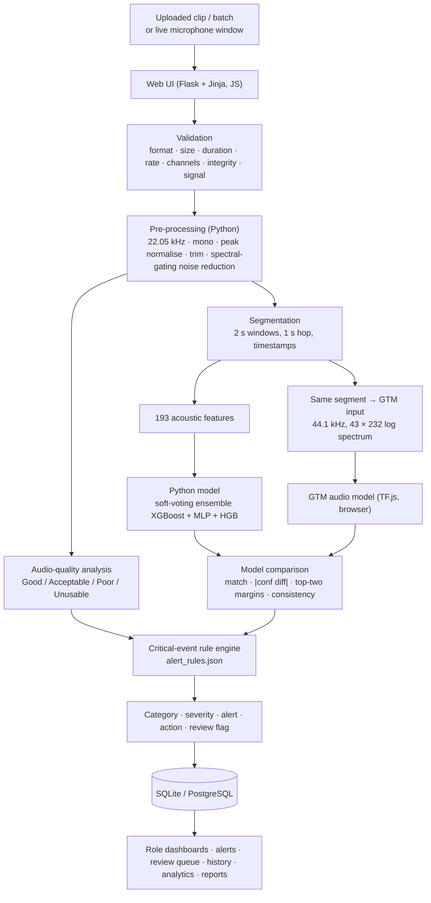
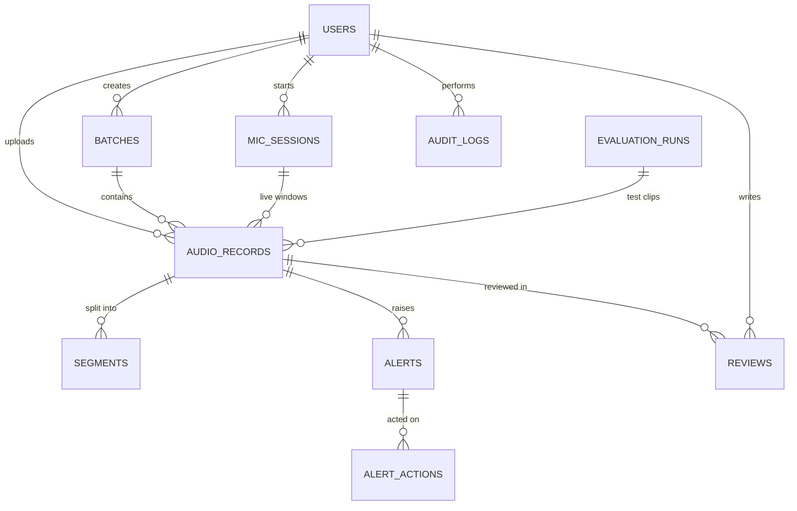
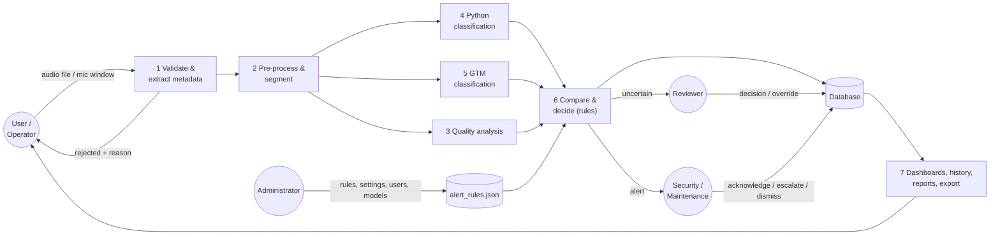
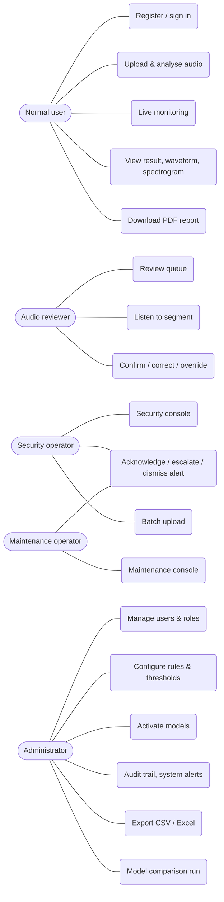
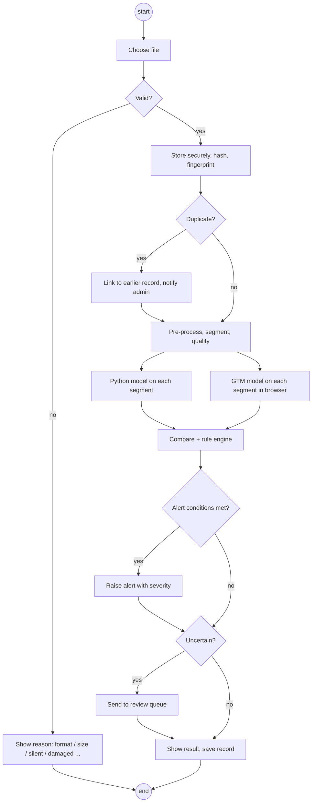
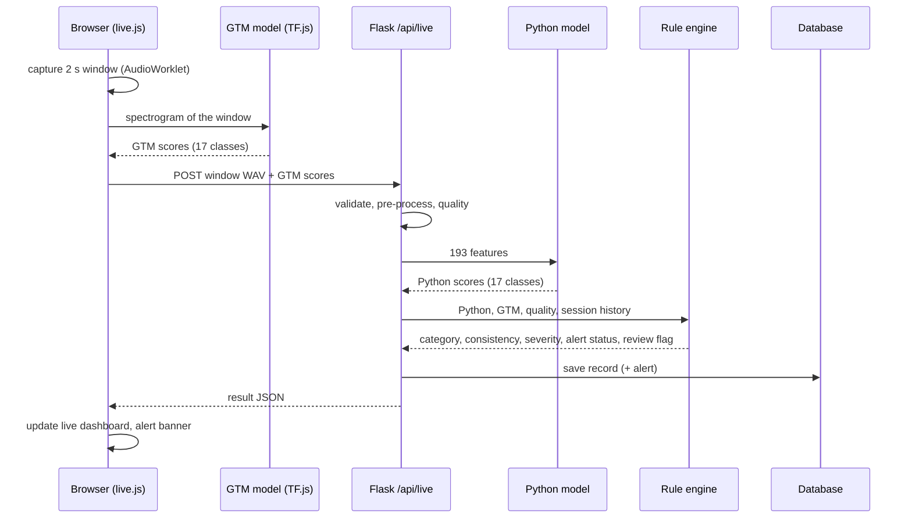

# SonicSentinel AI — Project Report

**Competition:** Aptech TechWiz 7 · Category: NextWave AI and ML · Theme: AcousticX Intelligence
**Specification:** SonicSentinel AI Software Requirements Specification (SRS) v1.0
**Report version:** 2.0 (27 September 2026)
**Team:** SFC-FutureMind — Haleema, Huma Kiran, Taha Mubashir Khan, Atiq Imran (see `documentation/TEAM_CONTRIBUTIONS.md`)

> SonicSentinel AI is a competition prototype for controlled and ethical testing. It is **not** a certified
> emergency-response or law-enforcement system.

All numbers in this report come from files in the repository (model cards in `python_models/saved/`,
`reports/`, `data/dataset_statistics.json`). Where a target was not met, the report says so.

---

## Contents

1. Problem definition
2. Background and business necessity
3. Proposed solution
4. Purpose
5. Scope
6. Assumptions
7. Constraints
8. Functional requirements (traceability)
9. Non-functional requirements (status)
10. Application architecture
11. Module descriptions
12. Database design and data dictionary
13. Diagrams (data flow, use case, activity, sequence, decision flow)
14. Audio-processing pipeline
15. Critical-event rule design
16. Dataset: description, collection method, label corrections, augmentation, upload and live renderings
17. Audio pre-processing and feature extraction
18. Python model design, training and evaluation
19. GTM model design, training and evaluation
20. Model prediction and confidence comparison
21. Noise robustness, false-positive and false-negative analysis
22. Testing strategy
23. Security
24. Privacy
25. Limitations
26. Future enhancements

---

## 1. Problem definition

Critical sounds — gunshots, breaking glass, screams, aggression, calls for help, alarms, machinery faults —
signal events that need a fast response. Today they are usually caught by people listening to live audio or
reviewing recordings after the fact. That is slow, tiring and inconsistent, and it breaks down in noisy or
crowded places. The problem is to **detect and classify these sounds automatically, in uploaded files and
from a live microphone, with a confidence the operator can trust, and to raise the right alert with the
right severity** — while sending anything uncertain to a human instead of guessing.

## 2. Background and business necessity

| Setting | Sound of interest | Cost of a missed / late detection |
|---|---|---|
| Factories, plants | Machinery fault | Equipment damage, downtime, injury |
| Public spaces, transport | Gunshot, scream, aggression, help request | Delayed emergency response |
| Shops, offices, homes | Glass breaking, alarm | Burglary, vandalism, fire |
| Farms, service centres | Animal sound, vehicle horn | Context / environmental monitoring |

Manual listening does not scale: one operator can follow a few streams at most, attention drops over a
shift, and different operators judge the same sound differently. An automatic first pass that is
explainable (confidence, agreement between two independent models, audio quality, rule check) lets a small
team cover many more sources and spend its time on the events that matter.

## 3. Proposed solution

A Flask web application with two input modes — **file upload** (single or batch) and **live microphone
monitoring** — and one analysis path:

1. validate the audio → 2. extract metadata → 3. pre-process (resample, mono, normalise, trim, noise
reduction) → 4. segment into 2-second windows → 5. assess audio quality →
6. **Python classifier** (193 acoustic features → soft-voting ensemble) and, independently,
7. **Google Teachable Machine (GTM) audio model** (speech-commands spectrogram → TF.js network, run in the
browser) → 8. compare the two models → 9. apply the critical-event rules (confidence, top-two margin, model
agreement, audio quality, repeated detection) → 10. severity, alert, recommended action and manual-review
routing → 11. dashboards, event history, reports and exports.

Five roles (normal user, audio reviewer, security operator, maintenance operator, administrator) each get
their own dashboard and permissions.

## 4. Purpose

This report documents the requirements, design, data, models, evaluation, testing, security and limitations
of SonicSentinel AI so that evaluators and developers share one understanding of what was built, how it
works and how well it performs.

## 5. Scope

**In scope:** the ten mandatory sound classes and the seven optional ones (17 in total, `config/classes.json`); upload, batch upload and live monitoring; validation,
pre-processing, quality analysis, feature extraction; a Python classifier (five algorithms compared plus two
ensembles); a GTM audio model integrated in the web app; model comparison; configurable alert rules;
alerts with acknowledge / escalate / dismiss / resolve; manual review with override; dashboards per role;
event history with search and filters; analytics; PDF report, CSV and Excel export; audit trail; data
retention; duplicate and near-duplicate detection.

**Out of scope:** certified emergency response, automatic contact with emergency services, speaker
identification, speech transcription, the optional categories (Drone, Fireworks, Vehicle Backfire,
Explosion, Door Impact, Graffiti Spray, Drilling/Grinder, Normal Machinery) — their names are reserved in
`config/classes.json` but there is no training data for them.

## 6. Assumptions

* Users grant microphone permission and read the privacy notice before live monitoring.
* A modern browser (Chrome, Edge, Firefox) with Web Audio API support; the GTM model runs in the browser.
* FFmpeg is installed for MP3 / M4A decoding (WAV, FLAC and OGG decode without it).
* Sound events of interest last at least ~0.5 s and are within the 0–5 kHz range the GTM model sees.
* A clip contains one dominant event; overlaps are flagged, not separated.

## 7. Constraints

* **Audio variability:** device, distance, reverberation, background noise and overlapping events change
  the signal a lot. Hidden tests may contain all of these.
* **Data:** accuracy depends on the size, balance and realism of the dataset. 3,000 of our 4,921 original
  clips are synthetic (section 16) — the largest risk to real-world accuracy.
* **Compute:** training ran on a laptop CPU (Windows 11, Python 3.14, 12 threads). The GTM fine-tune took
  64 minutes.
* **Two independent models** will not produce equal confidences; the comparison reports the difference
  instead of forcing agreement.
* **Privacy and consent:** audio is personal data; recording must be visible, consented and time-limited.

## 8. Functional requirements (traceability)

| SRS | Requirement | Where it is implemented |
|---|---|---|
| i | Registration and authentication | `src/blueprints/auth.py`, `templates/auth/` |
| ii | Role-based access control (5 roles) | `src/security.py` (permission matrix), role dashboards `src/services/role_dashboards.py` |
| iii | Profile, unique User ID | `User.user_code`, `/profile` |
| iv | Upload WAV / MP3 / FLAC / OGG / M4A | `audio_preprocessing/loader.py`, `/analyze` |
| v | Batch upload | `/api/batches`, `templates/analysis/batch.html` (operators and admin) |
| vi–vii | Live microphone start/stop, status (available, active, paused, disconnected, permission denied) | `static/js/live.js`, `src/services/live_service.py` |
| viii | Validation (format, size, duration, sample rate, channels, integrity, usable sound) | `audio_preprocessing/validation.py` |
| ix | Audio preview (play, pause, seek, volume) | `static/js/player.js` |
| x | Metadata extraction | `AudioRecord` columns, record page |
| xi | Pre-processing | `audio_preprocessing/preprocess.py`, `noise_reduction.py` |
| xii–xiv | Silence, clipping, background-noise estimation | `audio_preprocessing/quality.py` |
| xv | Segmentation with start/end timestamps | `segment_audio()`, `segments` table |
| xvi–xviii | Common dataset, metadata, balance checking | `scripts/build_dataset.py`, `data/dataset_metadata.csv`, `data/dataset_statistics.json` |
| xix | Augmentation | `augmentation/transforms.py`, `augment_dataset.py` |
| xx | Acoustic features | `feature_extraction/features.py` (193 features) |
| xxi–xxii | Waveform, spectrogram | `src/services/visuals.py` |
| xxiii–xxiv | ≥3 models, hyper-parameter tuning | `python_models/train.py` (5 algorithms, `RandomizedSearchCV`) |
| xxv–xxvi | Python class + confidence for all classes | `python_models/inference.py` |
| xxvii–xxx | GTM training, integration, independent classification, all-class confidences | `scripts/train_gtm_model.py`, `gtm_model/`, `static/js/gtm.js` |
| xxxi–xxxiii | Prediction and confidence comparison, consistency status | `alert_rules/engine.py` (`consistency_status`) |
| xxxiv | Top-3 predictions of each model | record page, live monitor |
| xxxv–xxxvi | Configurable confidence threshold and top-two margin | Admin → Settings, Admin → Alert rules |
| xxxvii–xxxix | Quality classes, uncertain detection, overlapping sounds | `quality.py`, `engine.py` |
| xl | Repeated-event confirmation | `engine.py` (`backward_counts`, `required_consecutive_detections`) |
| xli–li | Per-category behaviour (machinery, glass, alarm, horn, animal, gunshot, scream, aggression, help, background, unknown) | `alert_rules/alert_rules.json` |
| lii–liii | Severity assignment, configurable rules | Admin → Alert rules (versioned JSON with history) |
| liv–lvi | Real-time alerts, acknowledge / dismiss / escalate, alert history | `src/services/alerts_service.py`, `/alerts`, operator consoles |
| lvii–lxi | Review queue, playback, decision, comments, override (original outputs kept) | `src/services/review_service.py`, `/review`, review desk |
| lxii | Event statuses | `AudioRecord.status` |
| lxiii–lxv | User, live and administrator dashboards | `templates/dashboard/`, `templates/live/`, `templates/admin/dashboard.html` |
| lxvi | Timeline | `/timeline` |
| lxvii | Search and filters (ID, filename, category, dates, confidence, severity, quality, review status, user) | `analytics.apply_filters`, `/history` |
| lxviii | Analytics | `/analytics` |
| lxix | Downloadable PDF analysis report | `src/services/reports.py` |
| lxx | CSV / Excel export | `/history/export.csv`, `/history/export.xlsx` |
| lxxi–lxxii | Secure storage, database | `src/services/storage.py`, `src/models.py` |
| lxxiii–lxxiv | Duplicate (SHA-256) and near-duplicate (fingerprint) detection | `src/services/duplicates.py`, `audio_preprocessing/fingerprint.py` |
| lxxv | Model version on every prediction | `python_model_version`, `gtm_model_version` columns |
| lxxvi | Audit trail | `src/services/audit.py`, Admin → Audit trail |
| lxxvii | Error handling | validation messages, `templates/errors/error.html`, JSON errors |
| lxxviii | Monitoring and anomaly alerts | `src/services/monitoring.py`, Admin → System alerts |
| lxxix | Privacy controls | consent dialog, visible mic indicator, privacy notice |
| lxxx | Data retention | `src/services/retention.py`, Admin → Settings |

## 9. Non-functional requirements (status)

| NFR | Target | Measured | Status |
|---|---|---|---|
| Performance — upload | 30 s clip classified within 8 s | see `reports/performance.md` (`scripts/measure_performance.py`) | measured |
| Performance — live | window prediction within 3 s | tested in `tests/test_security_db_live.py` (warm model) | met |
| Scalability | ≥ 20,000 records | 20,000 records inserted in a test; history search and admin dashboard stay under 5 s (0.43 s warm) | met |
| Usability | intuitive UI for five roles | role-specific dashboards, responsive down to 390 px | met |
| Accuracy — GTM | ≥ 85 % accuracy, macro F1 ≥ 0.80, critical recall ≥ 85 % | 86.5 %, 0.871, min critical recall 91.1 % | **met** |
| Accuracy — Python | same | 83.4 %, 0.844, min critical recall 80.0 % (Person Asking for Help) | **accuracy and critical recall not met** |
| Availability | 99 % during evaluation | single-process Flask/Waitress; see deployment notes | depends on hosting |

## 10. Application architecture



The Python prediction is never sent to the GTM model; GTM receives only the audio segment (section 19).

## 11. Module descriptions

| Folder | Responsibility |
|---|---|
| `src/` | Flask app factory, blueprints (auth, analysis, live, alerts, review, history, analytics, admin), services, models, RBAC |
| `audio_preprocessing/` | decoding (`loader.py`), validation, pre-processing, noise reduction, quality analysis, fingerprints |
| `feature_extraction/` | 193-feature extractor, feature-matrix builder, browser-identical GTM spectrogram |
| `augmentation/` | noise, shift, pitch, stretch, volume, reverb, distance and device simulation |
| `python_models/` | training/tuning/comparison (`train.py`), inference, evaluation, saved models and model cards |
| `gtm_model/` | exported TF.js model, sample export for GTM, NumPy runner for the exported model |
| `alert_rules/` | rule file (`alert_rules.json` + versioned history), pure-Python decision engine |
| `config/` | class list (single source of truth), default settings |
| `database/` | SQLite database file (created on first run) |
| `scripts/` | dataset build/import, synthetic generation, GTM training, comparison report, performance measurement |
| `templates/`, `static/` | UI (HTML, CSS, JS; vendor libraries bundled locally) |
| `tests/` | pytest suite (section 22) |

## 12. Database design and data dictionary



Other tables: `model_versions`, `system_alerts`, `app_settings`, `id_counters`.

**Data dictionary (main fields)**

| Table.field | Type | Meaning |
|---|---|---|
| users.user_code | str(16), unique | User ID shown in the UI (`USR-…`) |
| users.role | str(20) | user · reviewer · security · maintenance · admin |
| users.failed_logins / locked_until | int / datetime | lock-out after repeated failures |
| audio_records.audio_id | str(24), unique | `SS-YYMMDD-NNNN` upload, `LV-…` live window |
| audio_records.source | str(12) | upload · batch · live · evaluation |
| audio_records.format, codec, duration, sample_rate, channels, bit_depth, file_size | | extracted metadata |
| audio_records.sha256, fingerprint, fp_descriptor | | exact and near-duplicate detection |
| audio_records.quality_label, quality_score, quality (JSON) | | Good/Acceptable/Poor/Unusable + measured issues |
| audio_records.python_top, python_confidence, python_scores (JSON), python_margin | | Python result for all classes |
| audio_records.gtm_top, gtm_confidence, gtm_scores (JSON), gtm_margin, gtm_status | | GTM result |
| audio_records.class_match, confidence_difference, margin_difference, consistency | | model comparison |
| audio_records.final_category, final_confidence, confidence_level, severity, alert_status | | final decision |
| audio_records.needs_review, review_reasons, uncertain_reasons, overlapping, overlap_classes | | review routing |
| audio_records.reviewed_category, reviewed_severity, reviewed_by, reviewed_at | | reviewer override (model outputs kept) |
| audio_records.python_model_version, gtm_model_version | | model version tracking |
| audio_records.status | str(20) | Uploaded · Classified · Uncertain · Alert Generated · Manual Review · Reviewed · Closed |
| segments.start_time, end_time | float | position of each 2 s segment in the original recording |
| alerts.alert_code, category, severity, status, responsible_roles, recommended_action, conditions (JSON) | | alert and the rule check that raised it |
| alert_actions.action, comment, escalate_to | | acknowledge · escalate · dismiss · resolve · reopen · comment |
| reviews.decision, original_category, reviewed_category, is_override, comment | | reviewer decisions |
| audit_logs.action, target, details (JSON), ip | | logins, uploads, mic sessions, predictions, alerts, reviews, overrides, exports, model and rule changes |

## 13. Diagrams

### 13.1 Data flow diagram (level 1)



### 13.2 Use case diagram



### 13.3 Activity diagram — analysing an uploaded file



### 13.4 Sequence diagram — live window



### 13.5 Decision flow diagram

```mermaid
flowchart TD
    q0{Quality Unusable?} -- yes --> U1[Unknown Sound · review]
    q0 -- no --> q1[Fuse Python + GTM scores 50/50]
    q1 --> q2{Fused conf &lt; 0.40?}
    q2 -- yes --> U1
    q2 -- no --> q3[Category = fused top class]
    q3 --> q4{Uncertain?<br/>conf &lt; 0.60 · margin &lt; 0.15 · poor quality ·<br/>disagreement · overlap}
    q3 --> q5{Alert enabled for category?}
    q5 -- no --> n1[No alert]
    q5 -- yes --> q6{conf ≥ rule min · margin ≥ rule min ·<br/>agreement if required · quality ≥ rule min ·<br/>repeated detection if required}
    q6 -- all pass --> A1[Alert Generated · severity from rule<br/>escalate if repeated]
    q6 -- only repetition missing --> A2[Pending (live) / Not confirmed (upload)]
    q6 -- other failure --> A3[Suppressed · review: critical without agreement / possible false alarm]
    q4 -- yes --> RV[Manual review]
```

## 14. Audio-processing pipeline

| Step | Implementation | Default |
|---|---|---|
| Decode | soundfile; FFmpeg fallback (MP3, M4A) | — |
| Validate | format by content sniffing, size, duration, sample rate, channels, integrity (incl. truncated WAV header check), loudest-frame signal test | 25 MB, 0.5–600 s, 8–192 kHz, ≤ 8 ch, silence −55 dBFS |
| Resample + mono | polyphase resampling, channel mean | 22,050 Hz |
| Normalise | peak normalisation | 0.95 |
| Trim silence | leading/trailing below top_db (offset recorded) | 40 dB |
| Noise reduction | adaptive spectral gating; skipped for stationary sounds (siren, hum) | max 12 dB |
| Segment | fixed windows, pad/truncate, start/end timestamps | 2 s, 1 s hop |
| Quality | silence, clipping, noise floor, low signal, duration, encoding problems, dropouts (missing frames) | → Good/Acceptable/Poor/Unusable |

The same pre-processing code runs for training and for prediction.

## 15. Critical-event rule design

Rules live in `alert_rules/alert_rules.json` (editable on Admin → Alert rules; every save is versioned in
`alert_rules/history/` and written to the audit trail). Each rule has: category, critical flag, alert on/off,
severity, minimum confidence, minimum top-two margin, required consecutive detections and repeat window,
model-agreement requirement, minimum audio quality, manual-review condition, escalation condition (repeated
detection or noise level) with target severity and who to notify, responsible roles, recommended action.

| Category | Severity | Alert | Min conf. | Min margin | Consecutive | Agreement | Min quality | Escalation | Responsible |
|---|---|---|---|---|---|---|---|---|---|
| Gunshot | Critical | yes | 0.70 | 0.20 | 2 | required | Acceptable | stays Critical, notify after 3 in 30 s | security |
| Panic Scream | Critical | yes | 0.70 | 0.15 | 1 | no | Poor | notify after 3 in 30 s | security |
| Person Asking for Help | Critical | yes | 0.70 | 0.15 | 1 | no | Poor | notify after 2 in 20 s | security |
| Aggression | High | yes | 0.65 | 0.15 | 1 | no | Poor | Critical after 3 in 30 s | security |
| Glass Breaking | High | yes | 0.70 | 0.15 | 1 | no | Acceptable | Critical after 3 in 30 s | security |
| Alarm or Siren | High | yes | 0.60 | 0.10 | 2 | no | Poor | - | security, maintenance |
| Machinery Fault | High | yes | 0.60 | 0.10 | 2 | no | Poor | Critical after 6 in 60 s | maintenance |
| Vehicle Horn | Low | no | 0.60 | 0.10 | 1 | no | Poor | Medium after 3 in 30 s (no alert) | security |
| Animal Sound | Low | no | 0.60 | 0.10 | 1 | no | Poor | - | security, maintenance |
| Background Noise | Informational | no | 0.50 | 0.10 | 1 | no | Unusable | Medium + alert if noise floor above limit | maintenance |

These are the shipped defaults; `alert_rules/alert_rules.json` is the authoritative, editable source.

**Repeated detection.** Live: consecutive windows are counted from the session history; an event that
needs two windows is *Pending* after the first and *Alert Generated* after the second. Uploads: runs of
equal categories across segments are counted; clips too short to repeat use model agreement instead.

## 16. Dataset

### 16.1 Description

One dataset serves both models (SRS step 5). Since 27 September 2026 it covers the **10 mandatory categories
and all 7 SRS optional categories** (17 classes, `config/classes.json`).

| | Count |
|---|---|
| Unique original clips | **7,866** (SRS minimum 3,000) |
| Augmented clips (training split only, not counted as originals) | 5,190 (one per training recording) |
| Split of originals (stratified, grouped by source) | train 5,506 · validation 1,179 · test 1,181 (70 / 15 / 15 %) |
| Total audio | 7.08 hours |
| Clip length | 0.3 – 5.5 s (mean 3.2 s) |
| Feature rows | 2 s segments in two renderings, upload and live microphone (section 16.5) |

| Class | Originals | Procedural synthesis | TTS speech | UrbanSound8K |
|---|---|---|---|---|
| Machinery Fault | 300 | 300 | 0 | 0 |
| Glass Breaking | 300 | 300 | 0 | 0 |
| Alarm or Siren | 600 | 300 | 0 | 300 |
| Vehicle Horn | 667 | 300 | 0 | 367 |
| Animal Sound | 742 | 450 | 0 | 292 |
| Gunshot | 665 | 300 | 0 | 365 |
| Panic Scream | 300 | 300 | 0 | 0 |
| Aggression | 300 | 172 | 128 | 0 |
| Person Asking for Help | 300 | 13 | 287 | 0 |
| Drone Sound *(optional)* | 300 | 300 | 0 | 0 |
| Drilling or Grinder Sound *(optional)* | 695 | 150 | 0 | 545 |
| Fireworks *(optional)* | 300 | 300 | 0 | 0 |
| Vehicle Backfire *(optional)* | 300 | 300 | 0 | 0 |
| Explosion *(optional)* | 300 | 300 | 0 | 0 |
| Door Impact *(optional)* | 333 | 333 | 0 | 0 |
| Graffiti Spray *(optional)* | 300 | 300 | 0 | 0 |
| Background Noise | 1,164 | 717 | 0 | 447 |

Every class has at least 300 originals. Classes are not equal (300–1,164); the balance checker in
`scripts/build_dataset.py` reports this and training compensates with class weighting.

### 16.2 Collection method and ethical sourcing

* **UrbanSound8K** (2,316 clips, CC-BY): real field recordings — sirens, car horns, dog barks, gun shots,
  drilling and jackhammers, and background (street music, children playing, air conditioners, idling
  engines). Imported with `scripts/import_urbansound8k.py`, which keeps the Freesound source id as the
  `source_group` so clips cut from one recording never cross splits, and spreads a class over as many source
  recordings as possible (`--per-source`).
* **Procedural synthesis** (5,135 clips, CC0, `scripts/generate_synthetic_dataset.py` with
  `scripts/synthetic/sources.py` and `optional_sources.py`): physically motivated generators for glass
  breaking, gunshots, screams, alarms, machinery faults, drones, fireworks, backfires, explosions, door
  impacts and spray cans, rendered with randomised device, distance (0.5–30 m), environment (small room,
  hall, factory, street, open field), reverberation, background (rain, wind, HVAC, traffic, crowd,
  conversation) and SNR 0–35 dB; some clips contain a second overlapping event at −8 to −16 dB.
* **Text-to-speech** (415 clips, CC0): the defined help phrases ("Help me", "Somebody help", "Please help",
  "Call for help", "Emergency"), aggressive shouting and calm everyday sentences, spoken by several
  synthetic voices (male, female, child) with different rates and pitches.
* No recordings of real people in distress were collected. No confidential or unlicensed audio is included.

Metadata for every clip (`data/dataset_metadata.csv`): Audio ID, root/parent Audio ID, original/augmented
status, class, split, filename, source, licence, duration, sample rate, channels, bit depth, format, size,
SHA-256, environment, device, distance, background, SNR, overlap, speaker, phrase, variant, quality label,
and for relabelled clips the previous Audio ID and the reason.

### 16.3 Label corrections and hard negatives (27 September 2026)

Testing the first models on sounds from outside the dataset exposed two label problems and one gap. All
three were fixed in the data rather than by tuning thresholds; `scripts/relabel_dataset.py` moves the
affected recordings and records the old Audio ID and the reason in `notes`.

| Problem found | Evidence | Change |
|---|---|---|
| A quiet empty room was classified **Machinery Fault** | UrbanSound8K `air_conditioner` and `engine_idling` had been imported as Machinery Fault, so the model had learned that any steady hum is a fault. Machinery Fault recall was 0.44 and 27 of its 45 test errors were confusions with Animal Sound. | 150 clips moved to **Background Noise** |
| Power tools were labelled as machine faults | UrbanSound8K `drilling` and `jackhammer` are working tools, not faults; the SRS lists them as their own optional category. | 150 clips moved to **Drilling or Grinder Sound**, plus 420 more imported from many source recordings |
| A camera shutter was classified **Gunshot at 94 %** | The dataset had no everyday impulsive sounds that are *not* events, so every sharp click looked like a gunshot. | New Background Noise material: empty rooms (mains hum, rumble, hiss), everyday clicks (camera shutters, light switches, keyboards, pens, staplers, mouse clicks) and calm neutral speech |

Animal Sound also gained horse, big-cat, wolf and elephant calls, because the class had only small animals
and a horse neigh came out as Unknown Sound. Synthetic Background Noise clips that contained a door closing
or knocking moved to Door Impact, which now covers those sounds.

### 16.4 Augmentation

`augmentation/transforms.py` — applied to training recordings only, one copy each, 2–3 random transforms per
copy: background-noise addition (3–25 dB SNR), time shift (up to ±0.5 s but never more than a quarter of the
clip), pitch shift (±2 semitones), time stretch (0.85–1.15), volume (−12 to +6 dB), reverberation (RT60
0.2–0.8 s), distance simulation (2–25 m), recording-device simulation (phone, laptop, headset, CCTV
microphone). An augmented copy keeps its root Audio ID and split.

### 16.5 Two renderings: upload and live microphone

An uploaded file and a live microphone window do not reach the model in the same shape. An upload is
trimmed and peak-normalised as a whole; a live window arrives through the browser's gain control, carries
the microphone's band limit and self-noise, and is normalised on its own with no trimming. A model trained
only on the upload rendering is therefore weaker on the live monitor than its reported accuracy suggests.

`feature_extraction/live_render.py` reproduces the live chain on dataset recordings — microphone band limit
and self-noise (four microphone profiles), a presence peak, distance attenuation, the browser's automatic
gain control, resampling to 22,050 Hz, then `preprocess_audio(window, trim=False)` per window, exactly as
`src/services/live_service.py` does. `feature_extraction/build_features.py` writes both renderings and marks
each row; `tests/test_dataset_tools.py` asserts that a rendered window is identical to what the live service
computes. Training uses both renderings; models are selected and reported on the upload rendering, and the
live rendering of the validation and test splits is reported separately (sections 18 and 19). The GTM
training script does the same through its `train-live` set.

### 16.6 Dataset challenges

* 71 % of originals are synthetic. Glass Breaking, Panic Scream, Machinery Fault and all seven optional
  categories are 100 % generated, and Person Asking for Help is 100 % synthetic speech. Real recordings of
  these sounds will differ, and the hidden-test accuracy may be lower than the numbers in this report.
* Machinery Fault lost its real recordings in the label correction above: the UrbanSound8K clips that had
  been in the class were construction tools and ambient hum, not faults. The class is now coherent but
  entirely generated, which is the most important gap to close with real recordings.
* Ethical constraints make real screams, aggression, gunshots and explosions impossible to record.
* UrbanSound8K does not record the device or the distance, so those metadata columns hold placeholders
  (`field_recorder`, 5 m) for its clips, marked as such in `notes`.

## 17. Pre-processing and feature extraction

193 features per 2-second segment (`feature_extraction/features.py`, 22,050 Hz, n_fft 2048, hop 512):

| Group | Features | Count |
|---|---|---|
| MFCC 1–20 | mean, std | 40 |
| Δ-MFCC 1–20 | mean | 20 |
| Mel spectrogram (32 summary bands of 64 mels) | mean, std | 64 |
| Chroma (12 pitch classes) | mean, std | 24 |
| Spectral contrast (7 bands) | mean, std | 14 |
| Spectral centroid, bandwidth, roll-off, flatness, zero-crossing rate | mean, std | 10 |
| RMS energy | mean, std, max, dynamic range, crest | 5 |
| Onset strength | mean, std, max, onset rate | 4 |
| Tempo | | 1 |
| Pitch (f0) | median, p10, p90, std, stability | 5 |
| Harmonic / percussive ratio | | 2 |
| Temporal shape | peak position, attack time, decay slope, temporal centroid | 4 |

A recording's result is the mean of its event segments' class probabilities.

## 18. Python model

### 18.1 Design and training

* Five algorithms tuned with `RandomizedSearchCV`, `GroupKFold` by root Audio ID (no leakage between
  folds), scoring = macro F1: SVM (RBF), Random Forest, Histogram Gradient Boosting, XGBoost, MLP.
* Two ensembles built from the best three (soft voting), one with critical-class weights
  (Gunshot 2.5, Panic Scream 1.75, Person Asking for Help 1.5, Aggression 1.25) tuned on validation.
* **Selection on validation** macro F1 (critical-class recall breaks ties). The test split is used only
  for the final report.
* Training data: 12,290 segments from 3,441 training recordings + 2,100 augmented copies.

### 18.2 Results (active model `py-v4-ensemble-weighted`, recording level)

| Model | Val acc. | Val macro F1 | Test acc. | Test macro F1 | Min critical recall (test) |
|---|---|---|---|---|---|
| SVM (RBF) | 0.853 | 0.859 | 0.834 | 0.841 | 0.689 |
| Random Forest | 0.871 | 0.866 | 0.812 | 0.814 | 0.711 |
| Hist. Gradient Boosting | 0.884 | 0.883 | 0.825 | 0.833 | 0.756 |
| MLP | 0.880 | 0.884 | 0.838 | 0.843 | 0.778 |
| XGBoost | 0.882 | 0.886 | 0.842 | 0.853 | 0.822 |
| Ensemble | 0.892 | 0.895 | 0.833 | 0.842 | 0.778 |
| **Ensemble + critical weighting (selected)** | **0.892** | **0.895** | **0.834** | **0.844** | **0.800** |

Test (741 recordings): accuracy 83.4 %, macro precision 0.852, macro recall 0.846, **macro F1 0.844**.

| Class | Precision | Recall | F1 |
|---|---|---|---|
| Machinery Fault | 0.690 | **0.444** | 0.541 |
| Glass Breaking | 1.000 | 0.978 | 0.989 |
| Alarm or Siren | 0.937 | 0.804 | 0.865 |
| Vehicle Horn | 0.907 | 0.880 | 0.893 |
| Animal Sound | 0.664 | 0.865 | 0.751 |
| Gunshot | 0.840 | 1.000 | 0.913 |
| Panic Scream | 0.957 | 1.000 | 0.978 |
| Aggression | 0.905 | 0.844 | 0.874 |
| Person Asking for Help | 0.818 | **0.800** | 0.809 |
| Background Noise | 0.800 | 0.844 | 0.822 |

Confusion matrices: `reports/python_model/py-v4-ensemble-weighted/confusion_matrix_*.png`.
The validation–test gap (0.895 → 0.844 macro F1) shows the model selection over-fitted the validation set
slightly.

## 19. GTM model

### 19.1 Design

The GTM model uses the **Teachable Machine audio architecture**: Google's speech-commands 18w
`BROWSER_FFT` base network with a new dense output layer (`NewHeadDense`), 17 outputs with the same class
names as the Python model. Input: 43 frames × 232 frequency bins (0–5 kHz) of the log-magnitude spectrum of
one second of 44.1 kHz audio — exactly what the browser `AnalyserNode` produces. The loudest second of each
2-second segment is used.

### 19.2 Training

* The same underlying recordings, splits, pre-processing and 2-second segments as the Python model
  (`gtm_model/export_gtm_samples.py` exports the training segments per class for the GTM project).
* Trained on both renderings of the training recordings: the upload rendering and the live-microphone
  rendering (section 16.5), 52,223 windows per epoch.
* Two variants compared on validation — frozen base + new head (Teachable Machine's own "transfer"
  training, 50 epochs) and the whole network fine-tuned end to end (20 epochs) — then critical-class
  weighting tuned on validation and folded into the output layer's bias.
* Confidence calibration: one temperature fitted on the validation windows and folded into the output layer
  (`logits / T`, T = 0.79), so the browser shows calibrated confidences without any extra code. Expected
  calibration error on the test windows fell from 0.053 to 0.017; the predicted class never changes.
* Training in PyTorch on CPU (1 h 46 min for the fine-tuning), exported to TF.js (`gtm_model/model/`); the
  export was verified against the trained network with a NumPy runner (max probability difference
  1.0 × 10⁻⁶ over 2,693 windows).

> **Note on Teachable Machine evidence.** The network is the Teachable Machine audio network and the
> exported files have the Teachable Machine format, but the fine-tuning was run with our own script
> because the Teachable Machine website only trains the output layer — that is the "transfer" variant
> below, and on 17 classes it reaches only 69.6 % test accuracy against 80.4 % for the fine-tuned network.
> The SRS asks for a GTM Audio Project with class screenshots: the team should also create the project on
> teachablemachine.withgoogle.com from the exported samples and add its link and screenshots under
> `screenshots/gtm/` (see `documentation/SUBMISSION_CHECKLIST.md`).

### 19.3 Results (`gtm-v6-tm-finetuned`, 1,181 test recordings, 17 classes)

| Variant | Val acc. | Val macro F1 | Test acc. | Test macro F1 | Min critical recall (test) |
|---|---|---|---|---|---|
| TM transfer (frozen base, the website's own training) | 0.688 | 0.713 | 0.696 | 0.717 | 0.511 |
| Previous export (`gtm-v4`, 10 classes, on these inputs) | 0.686 | 0.718 | 0.694 | 0.717 | 0.578 |
| Fine-tuned end to end | 0.817 | 0.841 | 0.804 | 0.823 | 0.790 |
| **Fine-tuned + critical weighting (selected)** | **0.817** | **0.840** | **0.803** | **0.823** | **0.770** |
| Live-microphone rendering of the same recordings | 0.815 | 0.838 | 0.798 | 0.816 | |

The live-microphone rendering scores within 0.6 points of the upload rendering, so the model is not weaker
on the live monitor than on uploads — the point of training on both renderings.

Class-wise on the test split, the weak spots are Background Noise (recall 0.477 — GTM pushes ambient
recordings into whichever event class they resemble), Drilling or Grinder Sound (recall 0.625, confused with
Machinery Fault) and Explosion (precision 0.536, pulling in fireworks and gunshots). Strong classes are
Drone Sound (1.000 recall), Glass Breaking (1.000), Graffiti Spray (0.978) and Vehicle Backfire (0.978).

Going from 10 to 17 classes cost GTM accuracy (0.865 → 0.803): the seven added categories include four
impulsive classes that overlap with Gunshot, and the one-second spectrogram the Teachable Machine network
sees carries less context than the Python model's 2-second, 193-feature description. GTM is now the weaker
of the two models and is below the 85 % target; the Python model is above it (section 18).

### 19.4 Independence

GTM receives only the audio of the segment. The Python prediction is computed on the server and is never an
input to GTM; `tests/test_alert_engine.py::test_python_prediction_is_not_an_input_to_gtm_scores` and the GTM
browser-parity tests in `tests/test_gtm.py` check this.

## 20. Model prediction and confidence comparison

For every analysed segment the app stores both predicted classes, every class confidence of each model, class
match, |Python top − GTM top| confidence difference, each model's top-two margin and the consistency status:

* **Acceptable Match** — same class, both ≥ 0.60, difference ≤ 0.25
* **Weak Match** — same class but a low confidence or a large difference
* **Model Disagreement** — different classes, both confident
* **Uncertain Result** — different classes with low confidence, or unusable audio

Comparison report (`reports/model_prediction_and_confidence_comparison_report.csv`, 100 unseen test
recordings, 10 per class): Python 89 %, GTM 92 %, final decision 91 %, class agreement 87 %, mean absolute
confidence difference 0.169, critical-class recall of the final decision 94 %. Consistency: 64 Acceptable
Match, 23 Weak Match, 3 Model Disagreement, 10 Uncertain Result.

Major disagreements: Aggression (agreement 60 %, Python 70 % vs GTM 90 %) — both classes are loud synthetic
speech, and the Python confusion matrix shows Person Asking for Help ↔ Aggression mix-ups; Vehicle Horn / Animal Sound (80 %) — tonal sounds with similar harmonics. On the full test
set GTM confuses sirens with horns, Python confuses machinery with animal sounds (section 21).

## 21. Noise robustness, false positives and false negatives

**Noise robustness.** `python_models/train.py` evaluates every model on test recordings with background
noise added at 20, 10, 5 and 0 dB SNR (`noise_robustness.json` in each model's report folder). The GTM
live-microphone evaluation (raw audio, no noise reduction) reaches 87.6 %, close to the 86.5 % of the
processed path. The training data already contain 0–35 dB SNR backgrounds and device simulation.

**False negatives (missed events), Python test set:**

| True class | Missed as | Count | Why |
|---|---|---|---|
| Machinery Fault | Animal Sound | 27 | engine/compressor harmonics look like growls in MFCCs |
| Machinery Fault | Gunshot | 14 | jackhammer impacts are impulsive |
| Machinery Fault | Background Noise | 9 | steady hum at low level |
| Alarm or Siren | Machinery Fault | 13 | steady tonal sound |
| Person Asking for Help | Aggression | 4 | both are loud speech |

**False positives:** Animal Sound has the lowest precision (0.664) because machinery and background clips
are pulled into it; Gunshot precision is 0.84 (impulsive machinery). The rule engine limits the effect of
false positives: Gunshot alerts need 2 consecutive detections, both models to agree and Acceptable audio;
an operator's "dismiss" sends the event to review as a possible false alarm.

**How the system reduces both:** agreement of two independent models, top-two margin, quality gate,
repeated detection, Unknown Sound below 0.40 confidence, and manual review of every uncertain case.

## 22. Testing strategy

`python -m pytest` — unit, integration and route tests on a throw-away database per test.

| SRS test type | Test file(s) |
|---|---|
| Functional, integration | `test_roles_workflow.py`, `test_gtm.py` |
| Boundary | `test_audio_io.py` (duration, size, sample rate, channel limits), `test_alert_engine.py` (thresholds) |
| Negative | `test_audio_io.py` (fake audio, empty, truncated, unsupported), permission tests |
| Security | `test_security_db_live.py` (login required, lock-out, hashed passwords, CSRF, open redirect, headers, record isolation), permission matrix |
| Database | `test_security_db_live.py` (relations, cascade, unique Audio ID, 20,000 records) |
| Audio format | `test_audio_io.py` (WAV subtypes, FLAC, OGG, MP3/M4A) |
| Microphone | `test_security_db_live.py` (consent, session status, windows, stop, isolation) |
| Silence, clipping, noise | `test_preprocessing_quality.py`, `test_audio_io.py` |
| Pre-processing, features | `test_preprocessing_quality.py`, `test_features_model.py` |
| Python model | `test_features_model.py` (probabilities for all classes, unseen clips) |
| CNN member | `test_cnn.py` (log-mel shape, padding of short live windows, NumPy forward pass equal to PyTorch within 1e-4, fusion weights) |
| GTM model | `test_gtm.py` (browser-identical spectrogram, exported model, label check) |
| Comparison, alert rules, low confidence, overlap | `test_alert_engine.py` |
| Duplicate audio | `test_security_db_live.py` (SHA-256 duplicate, re-encoded near-duplicate, fingerprint) |
| Hidden-test readiness | `documentation/HIDDEN_TEST_CHECKLIST.md` |

Results of the latest run are in `reports/test_results.txt`.

## 23. Security

* Passwords hashed with Werkzeug (PBKDF2/scrypt); password policy on registration.
* Lock-out after 5 failed sign-ins (configurable), failed logins audited and reported as system alerts.
* CSRF tokens on every form and JSON request; session cookies HttpOnly and SameSite=Lax; set `SESSION_COOKIE_SECURE=1` when served over HTTPS.
* Role and permission check on every route; alert actions limited to the responsible roles; users see only
  their own records unless their role allows otherwise.
* Security headers: Content-Security-Policy (no external scripts — all libraries are bundled), X-Frame-Options
  DENY, X-Content-Type-Options nosniff.
* Uploads: content sniffing (not just the extension), size limits, random stored filenames, files served only
  through permission-checked routes.
* Full audit trail of logins, uploads, microphone sessions, predictions, alerts, reviews, overrides, exports,
  model and rule changes.

## 24. Privacy

* Live monitoring starts only after the user accepts the microphone notice (consent is stored and audited).
* A visible indicator shows whenever the microphone is on; the app never records in the background.
* By default only live windows that contain an event are stored (`live.store_audio = events`).
* Retention: uploads 30 days, live audio 7 days, records 365 days (configurable; automatic daily clean-up).
* The help-phrase class is limited to defined safety phrases; no transcription or speaker identification.

## 25. Limitations

* **Python model accuracy is 83.4 %, below the 85 % target;** Person Asking for Help recall 80 % and
  Machinery Fault recall 44 % are the weak points. GTM meets the targets.
* 61 % of the training data is synthetic; real-world accuracy on the hidden test set may be lower than the
  numbers above.
* Overlapping sounds are detected (flagged), not separated into two events.
* GTM runs in the browser: if the browser cannot run it, the result is a Single-Model Result and critical
  events go to review.
* SQLite and a single server process suit a demo; production needs PostgreSQL and a process manager.
* Not a certified safety system; alerts must be verified by a person.

## 26. Future enhancements

* Record real, consented examples of the weak classes (machinery faults, help phrases, sirens) and retrain.
* Add a CNN on log-mel spectrograms to the Python ensemble.
* Train the optional categories (Fireworks and Vehicle Backfire to separate them from Gunshot; Normal
  Machinery to separate it from Machinery Fault).
* Sound-event separation for overlapping sounds; sound-source direction with microphone arrays.
* Push notifications (SMS, e-mail) for critical alerts; multi-site deployments with site maps.
